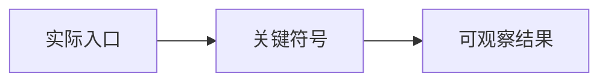
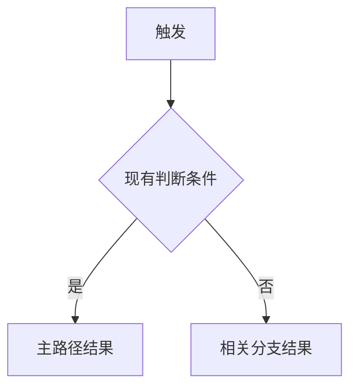
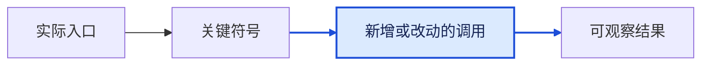
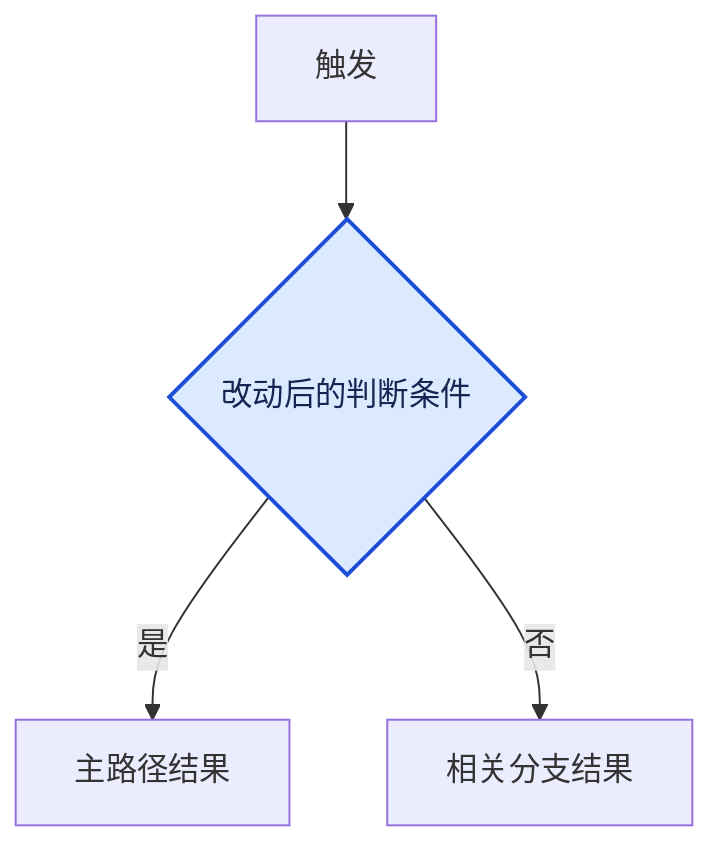

# 【{类型}】{业务线} - {仓库} - {主题}

# 1. 背景

写业务场景、系统职责、用户遇到的问题和影响。采用知识库或项目文档的业务术语，在相关段落末尾给出处。代码路径和实现细节放在后续章节。

# 2. 现状

**调用链**

沿实际入口列出触发点、关键符号、跨边界调用和可观察结果。为关键符号给出 `仓库/相对路径:行号`，单仓库可省略仓库名。按读者理解这次改动所需的粒度保留细节。改动前的定位以调查时的版本为准，必要时附提交号。

**流程图**

说明系统怎样判断、走向哪个结果。突出本次问题所在主路径，只保留会影响结果的分支。

# 3. 需求

**显性需求**。写用户直接提出的行为和验收条件。

**隐性需求**。写从既有功能、调用方或其他约束推断的要求，注明推断依据和可观察的验收条件。

# 4. 判断链

按依赖顺序列出需要回答的问题、选定答案和依据。用 `J1`、`J2` 等编号让切片能指回它实现的判断及答案。前一项影响后续选择时，写出具体关系。

# 5. 解决方案

两图用蓝色标出本次改动，节点或分支同时用文字说明变化。

**调用链**

沿用第 2 节的图和节点名称，更新实际代码路径、调用顺序与细节。用颜色和文字标出新增或改变的节点、路径；删除的路径仍可在第 2 节对照，并在对应切片里说明。

**流程图**

沿用第 2 节的流程，在颜色标出的节点或分支写明变化后的判断条件和去向。

## 切片一 · {可观察的行为变化}

- **功能**。写触发条件、改动前后的行为和结果。
- **定位**。把此切片涉及的文件和行号、流程图节点及必要的改动说明列在一起。
- **职责**。写本切片负责的行为，以及由其他切片或系统承担的行为。
- **判断**。写它实现了哪个判断的哪个答案，例如 `J1 → {选定答案}`。
- **验收**。写能独立验收的入口、前置条件、实际命令或操作、预期与实测结果、状态。可附测试证据链接。

后续切片采用同一结构。跨切片的构建或回归验证放在本节末尾，记录实际环境、命令、结果及未执行的相关用例。

# 6. 可复用的经验

写可迁移到其他问题的判断或做法，具体到适用条件和决策。没有可迁移的经验时留空。
