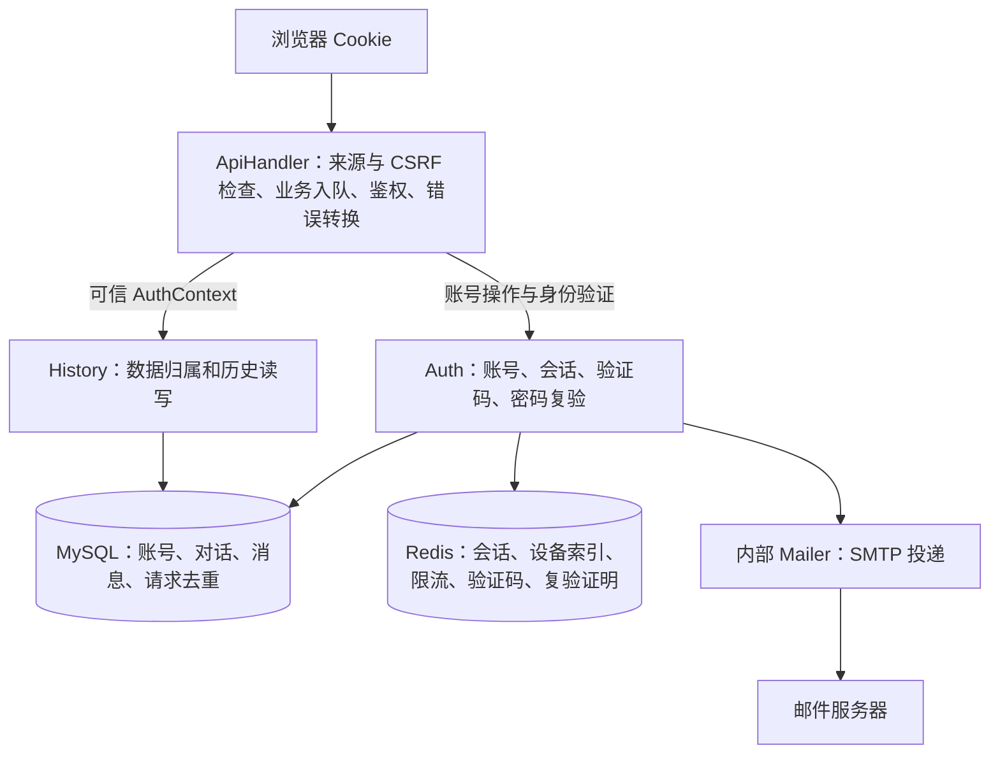

# 认证架构

账号、会话、验证码和敏感操作复验统一通过 `auth::Auth` 调用。MySQL 保存长期业务数据，Redis 保存有时效的认证状态，Mailer 负责 SMTP 投递。

## 调用关系



服务仍在一个进程内运行。账号和聊天请求使用有界业务线程池，模型调用使用独立的有界模型线程池。

## 文件与职责

| 文件 | 职责 |
| --- | --- |
| `backend/auth/Auth.hpp` | 唯一的认证业务接口：注册、登录、验证会话、退出、设备、密码和邮箱管理 |
| `backend/auth/Config.hpp` | 统一的认证配置与 SMTP 配置 |
| `backend/auth/Types.hpp` | 用户、会话、可信身份和认证结果类型 |
| `backend/auth/src/Auth.cc` | 账号业务、密码复验、事务和跨存储操作顺序 |
| `backend/auth/src/Session.cc` | Auth 的会话创建、校验、续期、设备索引和撤销实现 |
| `backend/auth/src/Codes.cc` | Auth 内部的验证码生成、冷却、尝试次数、单次消费和失效规则 |
| `backend/auth/src/AuthImpl.hpp` | Auth 的私有状态和内部方法声明 |
| `backend/auth/src/Mailer.hpp/.cc` | SMTP 投递和传输配置校验，不管理验证码或 Redis 状态 |
| `backend/core/src/Api.hpp/.cc` | HTTP 共用请求流程，按路由声明的访问策略调用 Auth |
| `backend/core/src/AuthRoutes.hpp/.cc` | 账号路由参数、Cookie 和响应编码 |
| `backend/history/` | 对话和消息的数据归属检查、持久化 |

HTTP 层认识 Auth 和 AuthContext；会话与验证码的 Redis 实现留在 Auth 内部。Auth 不依赖 HTTP、Cookie 或 History。

## 路由访问策略

每条账号或聊天路由明确选择 `Access::Public` 或 `Access::Authenticated`，共用 `ApiHandler`：

```text
来源与 CSRF 检查
→ 投递有界业务队列，队列满返回 503 busy
→ Authenticated 路由验证 Cookie，生成 AuthContext
→ 执行业务处理函数
→ 统一转换错误
```

注册、登录、找回和重置密码为 Public；账号设置、设备、模型、聊天和历史接口为 Authenticated。Public 路由也执行来源与 CSRF 检查。

找回密码在任务开始执行并校验请求结构后返回统一的 202 响应，再在同一任务中查询账号和发送邮件。邮箱存在与否、邮件投递结果不改变已经返回的受理结果。

History 使用 AuthContext 中的 user_id 检查数据归属，SQL 保留用户条件。设备撤销由 Auth 检查当前会话和目标会话是否属于同一账号。

## 状态与一致性

| 存储 | 权威数据 | 过期与原子性 |
| --- | --- | --- |
| MySQL | 账号、密码哈希、已绑定邮箱及聊天业务数据 | 事务、账号行锁、唯一索引和归属条件 |
| Redis | 登录会话、设备索引、会话安全戳 | TTL、Redis 时间、Lua 原子校验与续期 |
| Redis | 验证码、冷却和尝试次数 | TTL、Lua 原子校验与单次消费 |
| Redis | 限流计数、当前会话的密码复验证明 | 固定窗口、短时 TTL |

每次登录生成随机 token，Cookie 保存原始凭证，Redis 使用其 SHA-256 摘要作为会话 ID。密码使用带随机盐的 scrypt 哈希。默认会话闲置上限为 1 天，有效请求续期 Redis 会话、设备索引与浏览器 Cookie；持续使用没有固定的累计登录期限。`expires` 和 API 的 `expires_at` 表示当前闲置到期时间。

会话 Hash 的 `security_stamp` 保存创建时的用户安全戳，校验时与 `<session_namespace>:user:<uid>` 的当前值比较。退出所有设备或修改密码会更换用户安全戳，旧会话下次校验即失效。邮件验证码使用独立的安全戳：验证码 Hash 保存 `security_stamp`，当前值存于 `<email_namespace>:<uid>:security_stamp`。

登录与改密锁定同一 MySQL 用户行。改密先撤销 Redis 会话、作废验证码，再更新并提交 MySQL 密码哈希；跨存储失败仍可能导致密码未改变而设备已退出。验证码消费后账号更新失败，需要重新申请验证码。结果未知的写入不自动重放。

## 改造前后

| 项目 | 改造前 | 当前 |
| --- | --- | --- |
| 公开业务对象 | Account、Session、Email | Auth |
| 服务组装 | 创建三个对象并连接依赖 | 创建一个 Auth |
| 会话操作 | Account 转发，HTTP 也直接调用 Session | Auth 直接实现，内部共享状态 |
| 验证码规则 | Account 和 Email 协作 | Auth 内部统一管理 |
| 邮件发送 | 与验证码状态管理混合 | 私有 Mailer 只负责投递 |
| HTTP 请求流程 | Anonymous、RequireSession 和找回密码各自处理入队 | ApiHandler 共用流程，路由显式选择策略 |
| 配置对象 | AccountConfig、SessionConfig、EmailConfig | auth::Config |

HTTP 接口路径、请求和响应字段、JSON 配置字段及 MySQL 表结构沿用原有约定。

### 安全戳字段迁移

从使用 `generation` 的版本升级时，先构建新服务，再停止使用同一组 namespace 的所有旧服务，执行 [迁移脚本](../scripts/migrate-security-stamp.lua)，最后启动新服务。脚本将会话和验证码 Hash 的 `generation` 字段改为 `security_stamp`，并将邮件验证码的 `:generation` Key 改为 `:security_stamp`；保留原值与 Key 的过期时间。用户会话安全戳的 `:user:<uid>` Key 保持原名。

以下命令在项目根目录运行，连接参数应与服务配置一致；自定义 namespace 时替换最后两个参数：

```bash
redis-cli --eval scripts/migrate-security-stamp.lua , auth:session auth:email
```

脚本返回迁移的会话字段数、验证码字段数和邮件安全戳 Key 数。重复执行返回零；若新旧标记冲突，脚本会在写入前报错。回退旧服务需要先将字段和邮件安全戳 Key 恢复为旧名。

## 验证方式

`checks/auth_integration.py` 使用独立 MySQL、Redis、TLS SMTP 和模拟模型上游，验证登录、设备撤销、跨实例改密、会话到期、邮箱复验、验证码单次消费、限流、CSRF、数据隔离及依赖故障。宿主机缺少数据库命令时，测试辅助脚本启动临时 Docker 容器。

```bash
CHAT_SERVER="$PWD/build-binary/server" python3 -m unittest discover -s checks -p auth_integration.py -v
CHAT_SERVER="$PWD/build/server" python3 -m unittest discover -s checks -p auth_integration.py -v
```

`checks/auth_storage_test.cc` 通过 Auth 的公开接口验证会话分页、撤销、旧会话字段补入及到期过滤，同时覆盖数据库连接池、事务、参数值和历史一致性；编译时启用 assert。
